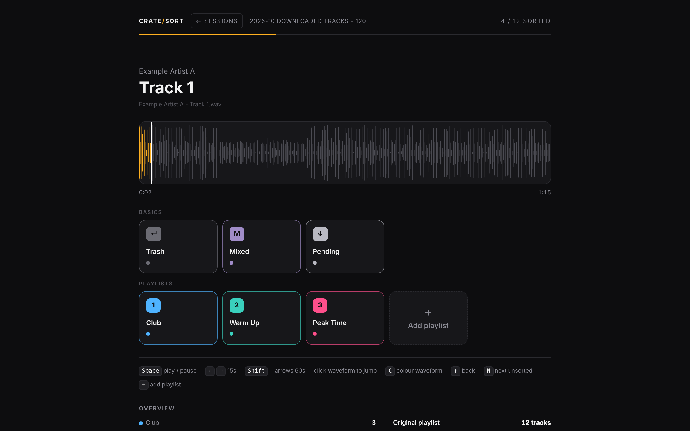
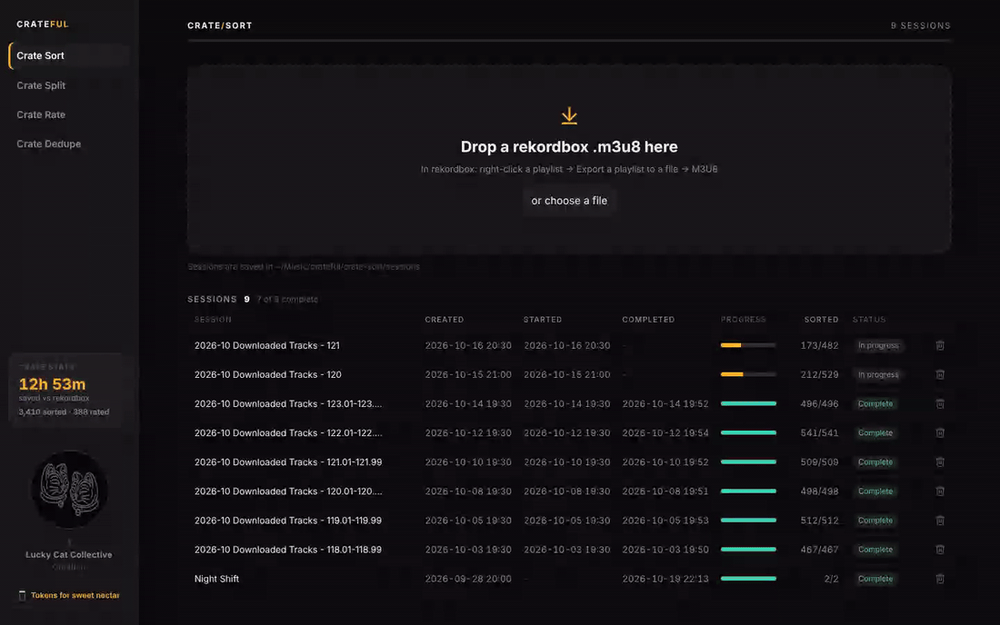
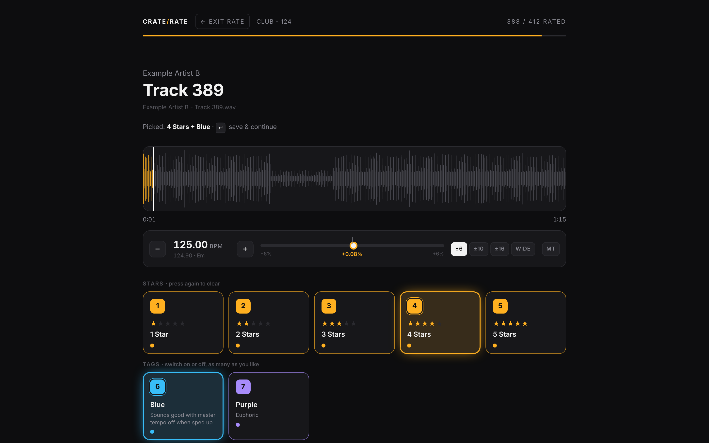
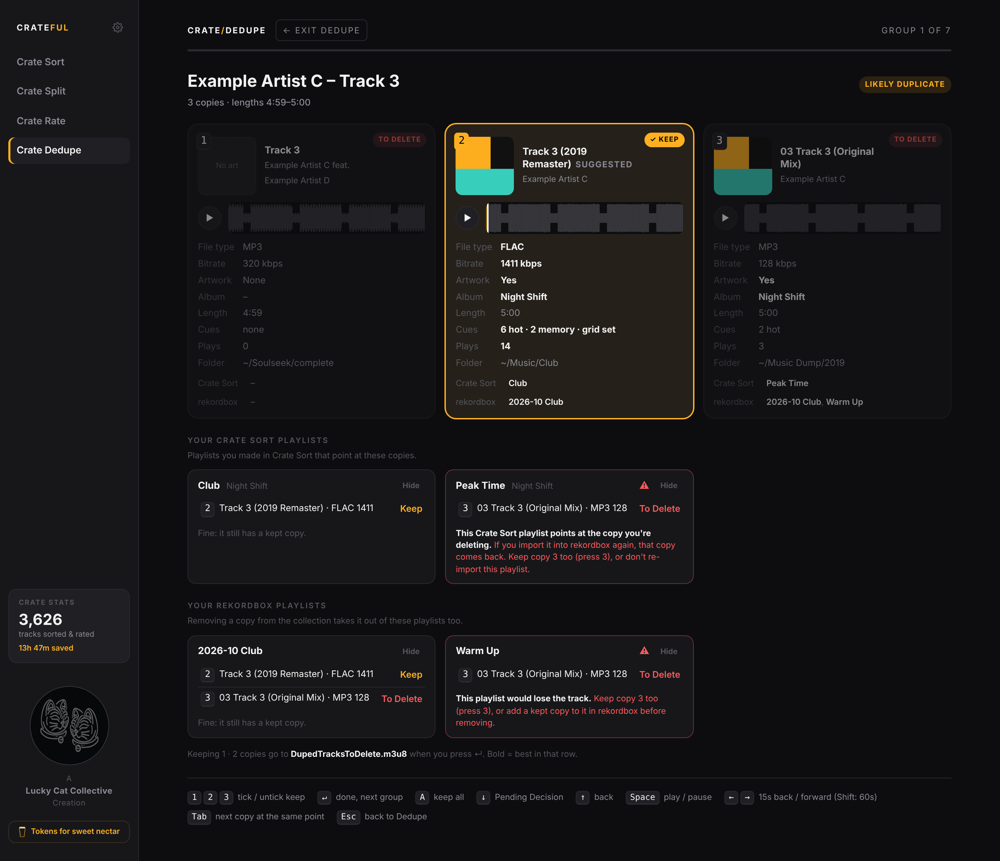
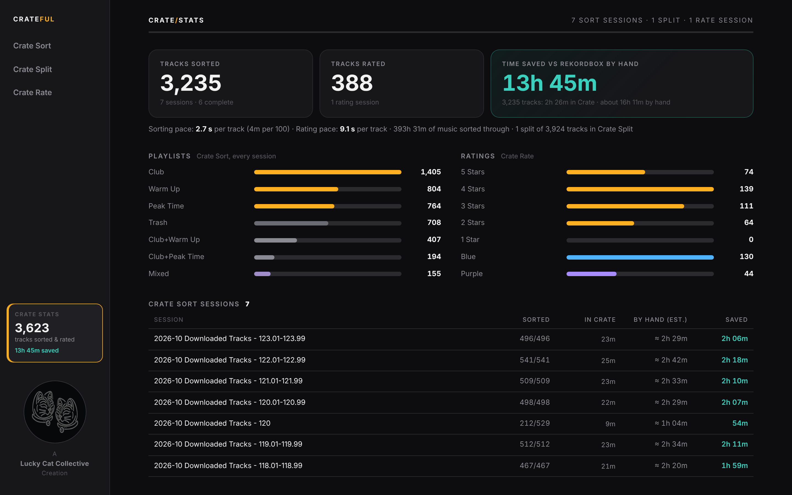

# Crateful

**Simply sort your exported rekordbox.m3u8/.txt files.** 
Listen to a track, press one key, move on. One key can drop a track into several playlists at once. 
Sort, split by BPM, rate, clear out duplicates, and see the hours you've saved.

**[Download Crateful for Mac](https://github.com/SeanCreaney/crateful/releases/latest)**

### One key, several playlists

The thing rekordbox can't do: put a track into **Club** *and* **Peak Time** with a single key press. Make a combo once (say **4 = Club + Peak Time**), and every time you press 4 the track lands in both playlists and the next one starts playing. No dragging the same track twice, no Ctrl-clicking playlists. Make as many combos as you like, and Crate Rate tags work the same way.

### Get started

1. Download **Crateful-mac.zip** from the [latest release](https://github.com/SeanCreaney/crateful/releases/latest) and unzip it.
2. Drag **Crateful** into your **Applications** folder.
3. Open it. The first time, macOS says it can't check the app (it isn't from the App Store). Go to **System Settings → Privacy & Security**, scroll down, click **Open Anyway** and confirm. You only do this once.
4. Drop a rekordbox `.m3u8` export onto Crate Sort and start sorting. Everything saves as you go.

Needs macOS 11 (Big Sur) or newer. Works on Apple Silicon and Intel Macs.

> [!NOTE]
> Built and tested on macOS with rekordbox exports. Sorting and rating use plain `.m3u8` playlists, so other DJ software should work too, but hasn't been tested yet.

## The tools

| | |
|---|---|
| **Crate Sort** Drop a `.m3u8` export and give every track one key. Enter for Trash, M for part of a mix, ↓ to decide later, 1–9 and 0 for your playlists. **Combos put a track in several playlists with one key** (e.g. 4 = Club + Peak Time). **Finish** writes everything into `FOR IMPORTING/`, ready for rekordbox. |  |
| **Crate Split** Drop a rekordbox `.txt` export and get one playlist per BPM, e.g. `2026-10 Downloaded Tracks - 120.01-120.99`. Tracks on an exact whole BPM can get their own playlist. Optionally starts a sorting session for each one. |  |
| **Crate Rate** 1–5 stars plus your own tags (e.g. *Purple: Euphoric*), then Enter to save and continue. A tempo fader (±6 / 10 / 16 / WIDE) with master tempo lets you hear how a track holds up sped up, and −/+ jumps to the next whole BPM. |  |
| **Crate Dedupe** Drop rekordbox's collection `.xml` and go through your duplicates one song at a time: every copy side by side with its file type, bitrate, artwork, album, cues, plays and folder, plus its own player so you can hear the difference. The best copy is ticked for you; 1–9 changes what you keep, Enter moves on. It warns you before you lose a playlist, your cues or a Crate Sort playlist. Crateful deletes nothing: the copies to get rid of go into one playlist, `DupedTracksToDelete.m3u8`, to remove in rekordbox. |  |
| **Crate Stats** Tracks sorted and rated, duplicates cleared, your real pace, and the time saved compared with doing the same in rekordbox. Every key press is timed, with breaks left out. Time saved counts finished sessions; ones you're part way through are marked in progress. |  |

## Crateful vs sorting in rekordbox

| | rekordbox | Crateful |
|---|:---:|:---:|
| One key per track, no dragging or scrolling | ✗ | ✓ |
| **Add a track to several playlists with one key** (e.g. Club + Peak Time) | ✗ | ✓ |
| Know exactly where you left off, and how far through you are | ✓ | ✓ |
| Park unsure tracks and get taken back to them at the end | ✗ | ✓ |
| Split a dump into one playlist per BPM in one go | ✗ | ✓ |
| Compare duplicate copies side by side and keep the best one | ✗ | ✓ |
| See how long it took and the time you saved | ✗ | ✓ |
| Time per 100 tracks (real sessions) | ~30 min | **~5 min** |

## Keys

<b>Crate Sort</b>

| Key | Does |
|---|---|
| Enter | Trash |
| M | Mixed (part of a mix) |
| ↓ | Pending Decision: revisited at the end |
| 1–9, 0 | your playlists and combos (add them with **+ Add Playlist** or the + key). A combo is one key for several playlists, e.g. 4 = Club + Peak Time |
| ↑ | back to the last track |
| Space | play / pause |
| ← → | jump 15 s (Shift: 60 s), or click the waveform |
| N | next unsorted track |
| C | colour (RGB) waveform |

<b>Crate Rate</b>

| Key | Does |
|---|---|
| 1–5 | star rating (press again to clear) |
| 6–9, 0 | your tags: switch on or off, as many as you like |
| Enter | save and continue |
| ↓ | Pending Decision |
| [ ] | BPM down / up to the next whole number |
| \ | tempo back to 0 |
| T | master tempo on / off |

<b>Crate Dedupe</b>

| Key | Does |
|---|---|
| 1–9 | tick / untick Keep on a copy (keep more than one if you like, e.g. the FLAC and one MP3) |
| Enter | done with this song, next |
| A | keep all: they aren't duplicates |
| ↓ | Pending Decision |
| ↑ | back to the last song (choosing again replaces what you picked) |
| Space | play / pause |
| ← → | jump 15 s (Shift: 60 s), or click a waveform |
| Tab | the next copy at the same point (Shift+Tab: the one before) |
| Esc | stop for now (the song you were on stays undecided) |

## Getting results into rekordbox

Drag the `.m3u8` files from a session's `FOR IMPORTING/` folder into rekordbox (or **File → Import → Import Playlist**). Tracks match your existing collection by file location, so cues, grids and ratings stay intact.

**Duplicates:** import `crate-dedupe/FOR IMPORTING/DupedTracksToDelete.m3u8`, select all its tracks and choose **Remove from Collection**. The copies you kept stay, with their cues and playlists. Don't move or rename files before you've done this (rekordbox matches by location). Removing from the collection doesn't delete the files from your drive.

## Settings

Open **Crateful → Preferences…** in the menu bar (or press ⌘,):

- **Music folder:** where your sessions, splits and ratings are saved (`~/Music/crateful` to start with). Pick a new one and choose to move your sessions there or start fresh. Nothing is ever deleted.
- **Start each track:** from the top, or partway in (say 30%) to skip long intros.
- **New versions:** Crateful checks GitHub once a day and shows a note in the sidebar when there's an update.

More: <code>crateful.config.json</code>

Preferences are saved in `crateful.config.json` in `~/Library/Application Support/Crateful/` (Finder: **Go → Go to Folder…**). Two more settings can be added there by hand (restart Crateful after):

| Setting | What it does | Default |
|---|---|---|
| `rate_tags` | Crate Rate tag keys to start with (6–9, 0), each with a name, note and colour | none |
| `hand_seconds_per_track` | Crate Stats: seconds per track doing the same in rekordbox | `18` (30 min per 100) |

## FAQ

**Does it change my music or my rekordbox library?** 
*No. Audio files are only read. Crateful writes playlists into its own folder (`~/Music/crateful`), and nothing reaches rekordbox until you import a playlist yourself.*

**Can a track go into more than one playlist, say Club and Peak Time?** 
*Yes, with one key. Add Club and Peak Time as playlists, then add one more key and tick both of them: that makes a combo. One press of it (say 4 = Club + Peak Time) puts the track in both and moves on. Doing the same in rekordbox means dragging the track into each playlist one by one. In Crate Rate, tags work the same way: switch on as many as you like, then Enter.*

**What happens when I import into rekordbox? Are my old playlists affected?** 
*Each `.m3u8` in `FOR IMPORTING/` comes in as a new playlist. Your existing playlists aren't touched, and tracks aren't duplicated: rekordbox matches them to the tracks already in your collection. If a playlist with the same name already exists, you'll get a second one beside it, so delete or rename the old one if the new one replaces it.*

**My music is organised in folders, with matching folders in rekordbox. Does Crateful change that?** 
*No. Crateful never moves, renames or copies your music. The playlists it makes just point to the files where they already are, so your folders on disk stay exactly as they are. In rekordbox, drag the imported playlists into whichever playlist folder you like.*

**Do I need rekordbox?** 
*Not for Crate Sort or Crate Rate: they work with any `.m3u8` playlist, whichever app made it. Crate Split and Crate Dedupe need rekordbox: Split reads rekordbox's `.txt` export (that's where the BPMs come from), Dedupe its collection `.xml`.*

**Does Crate Dedupe delete my duplicates?** 
*No. Crateful never deletes or moves a file. The copies you don't keep go into one playlist, `DupedTracksToDelete.m3u8`, and you remove them in rekordbox yourself (see Getting results into rekordbox). A copy whose file can't be found is never put in it, and a song only goes in once you've kept at least one copy that's actually on your drive.*

**Why does Crate Dedupe need the collection XML?** 
*It's the only export that has everything needed to choose: every track in your collection with its file type, bitrate, length, cues, beat grid, play count and the playlists it's in. In rekordbox: **File → Export Collection in xml format**, then drop the file on Crate Dedupe. Artwork is read from the music files themselves (read only).*

**I've deduped before. What happens when I drop a newer XML?** 
*Crateful remembers what you chose, so songs you've done don't come up again. Copies you've removed in rekordbox are counted as removed, copies still waiting are shown as waiting (not asked again), and only new duplicates come up, including a new copy of a song you've already deduped.*

**My music lives on an external drive. Does that work?** 
*Yes. Crateful plays each track from wherever the playlist says it is, external drives included. Just have the drive plugged in while you sort. Crateful's own sessions are saved on your Mac in `~/Music/crateful`.*

**Is my library uploaded anywhere?** 
*No. Crateful runs entirely on your Mac and never sends anything about your library. The only thing it does online is ask GitHub once a day whether there's a new version (you can turn that off in Preferences).*

**How do I update?** 
*When there's a new version, a note appears in the sidebar (or use **Crateful → Check for Updates…**). Download it, and drag the new Crateful into Applications to replace the old one. Your sessions aren't touched: they live in your music folder, not in the app.*

**Do I need anything installed?** 
*No. Crateful is a normal Mac app: download, drag to Applications, open.*

**Which audio formats play?** 
*MP3, WAV, AIFF, FLAC and M4A/AAC.*

**Why does macOS warn me the first time I open it?** 
*Crateful is free and isn't sold through Apple, so it isn't signed with a paid Apple developer account. Use **Open Anyway** (see Get started) once and it opens normally after that. Only download it from this repository's Releases.*

**My drive isn't plugged in. What happens?** 
*Tracks show "File not found". Plug the drive in, go back to the session list and open the session again.*

**Does it work with Serato, Traktor or Engine DJ?** 
*Crate Sort and Crate Rate use plain `.m3u8` playlists, so they should. Crate Split and Crate Dedupe read rekordbox's own exports specifically. Not tested yet: feedback welcome.*

## Disclaimer

Crateful is an independent project and isn't affiliated with or endorsed by AlphaTheta or Pioneer DJ. rekordbox is a trademark of AlphaTheta Corporation. Provided as is, without warranty. Only download Crateful from this repository's Releases.

## Support

Crateful is free. If it saves you hours:

 
A Lucky Cat Collective Creation
 
ssentif eht ssentiw

