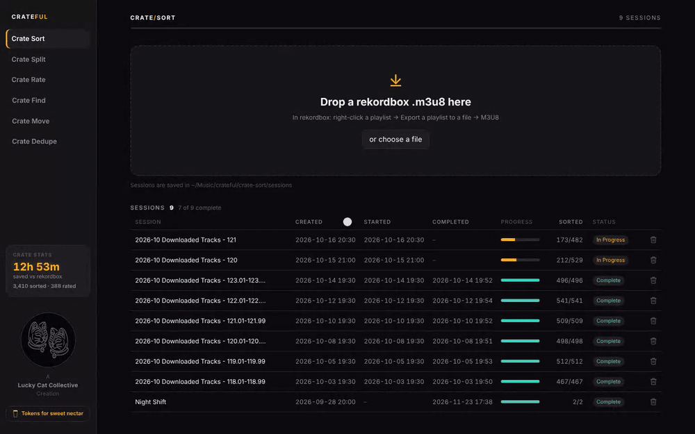
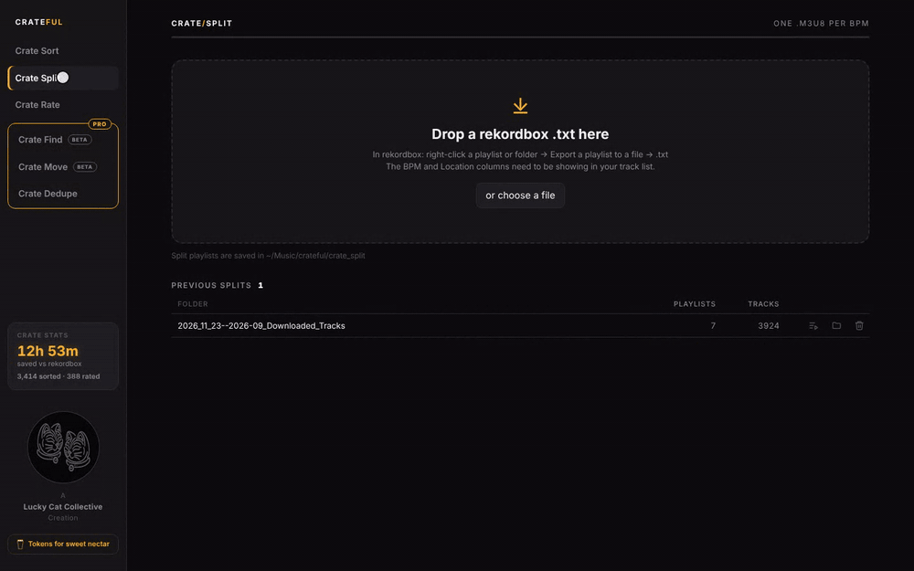
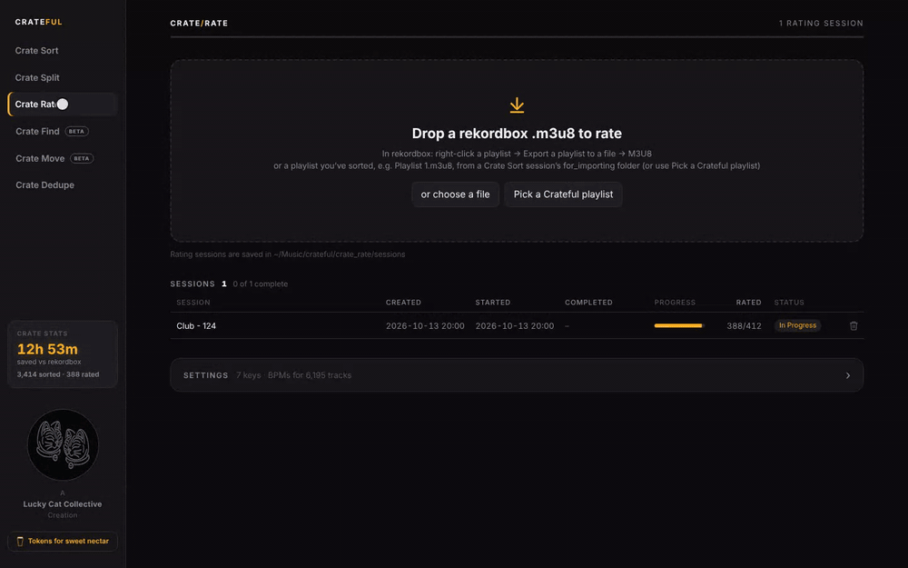
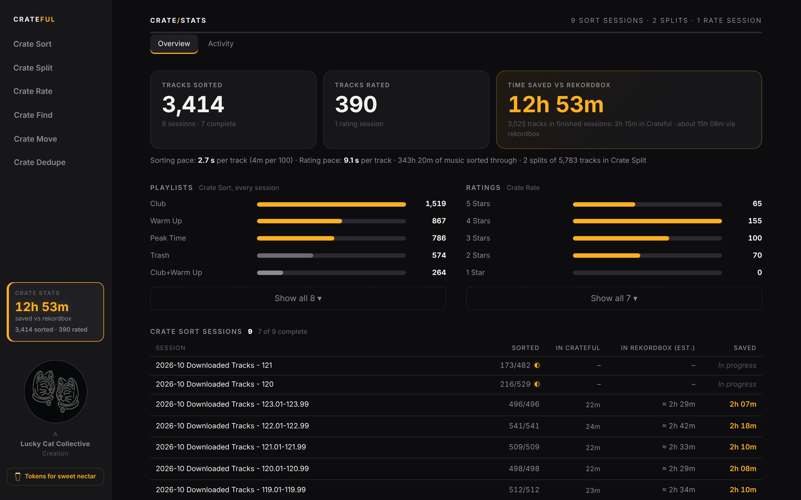
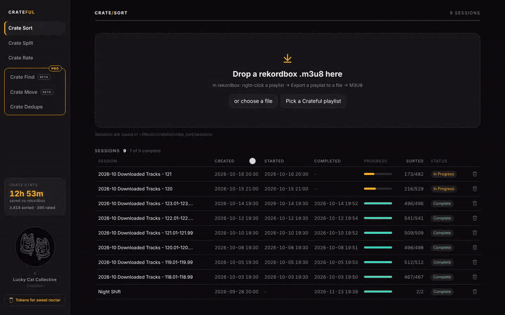
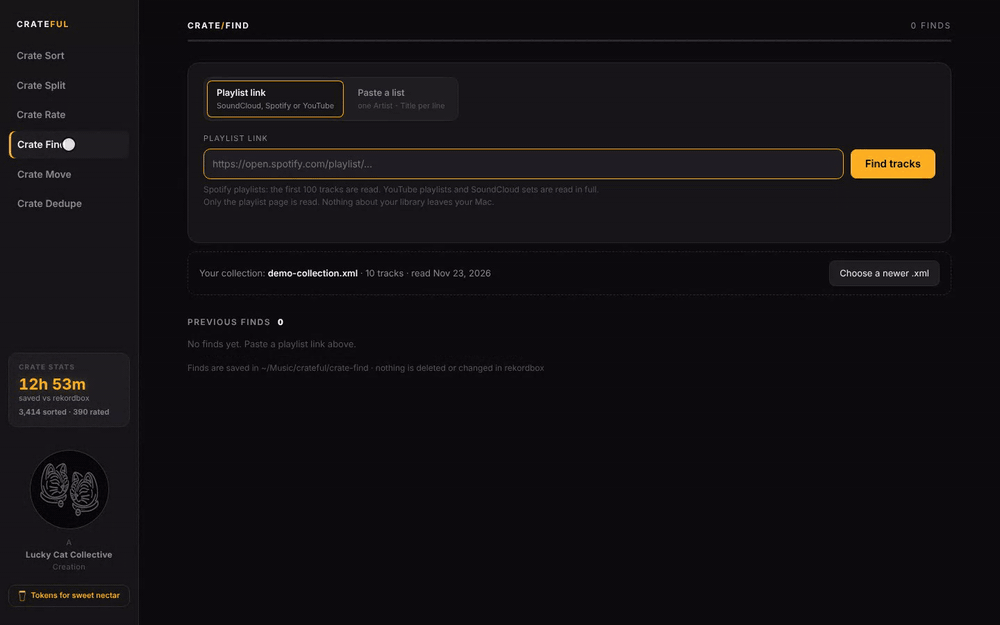
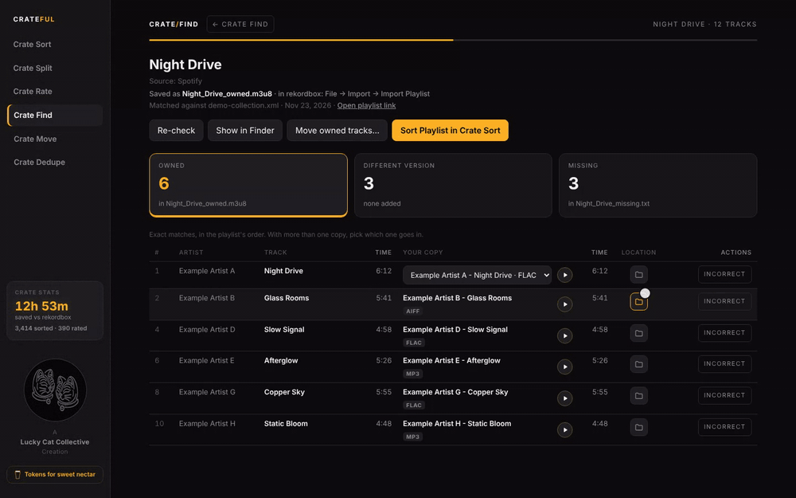
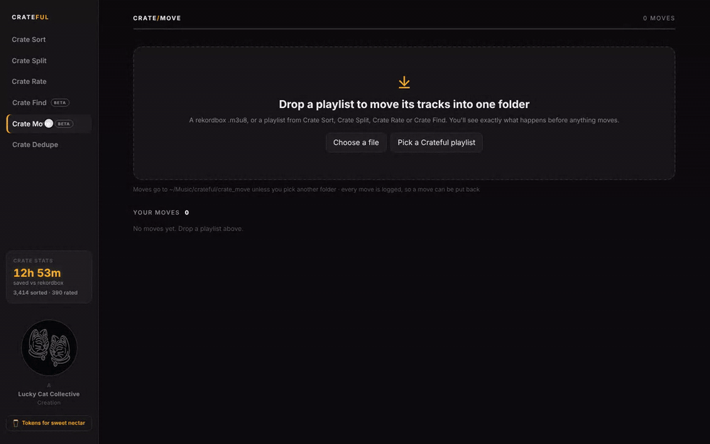
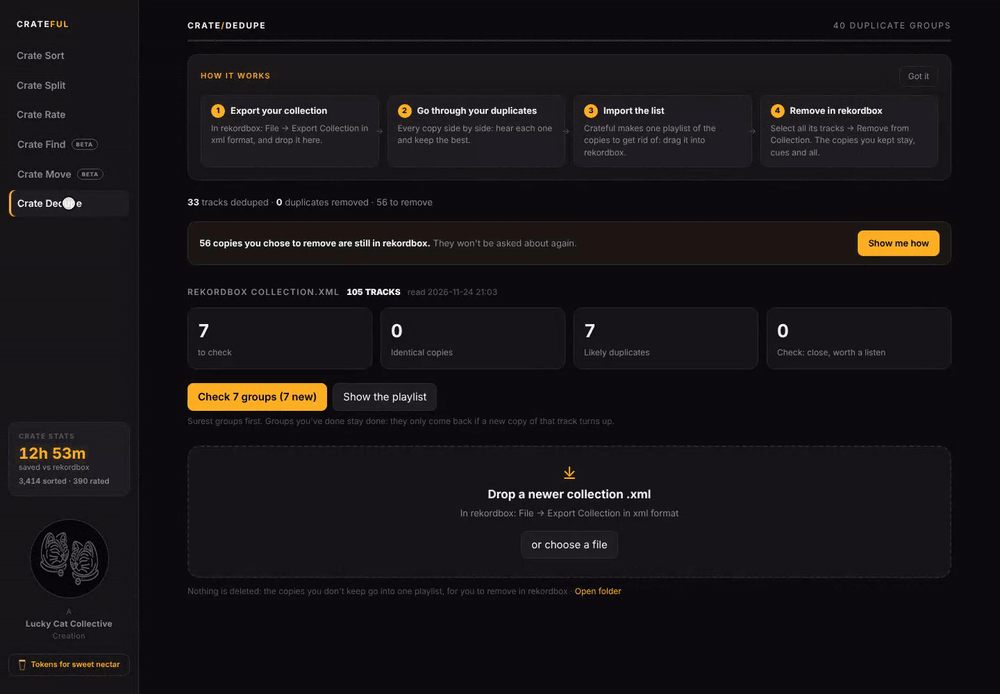

<div align="center">

# Crateful

**Sort your rekordbox playlists at the speed you listen.**<br>
Hear a track, press a key, next. Put a track into several playlists in one press.<br>
Free to sort, split and rate. **PRO** finds what you already own, gathers playlists into folders, clears out duplicates and tells any track's whole story.


**[Download Crateful for Mac](https://github.com/SeanCreaney/crateful/releases/latest)**



[Free tools](#free-tools) · [PRO tools](#pro-tools) · [Get started](#get-started) · [Keys](#keys) · [FAQ](#faq) · [Report a bug](https://github.com/SeanCreaney/crateful/discussions)

</div>

## Get started

1. Download **Crateful-mac.zip** from the [latest release](https://github.com/SeanCreaney/crateful/releases/latest) and unzip it.
2. Drag **Crateful** into your **Applications** folder.
3. Open it. The first time, macOS says it can't check the app (it isn't from the App Store). Go to **System Settings → Privacy & Security**, scroll down, click **Open Anyway** and confirm. You only do this once.
4. Drop a rekordbox `.m3u8` export onto Crate Sort and start sorting. Everything saves as you go.

Needs macOS 11 (Big Sur) or newer. Works on Apple Silicon and Intel Macs.

| | Free | PRO |
|---|:---:|:---:|
| **Crate Sort**: sort a playlist with your keys | ✓ | ✓ |
| **Crate Split**: one playlist per BPM | ✓ | ✓ |
| **Crate Rate**: stars, tags and a tempo fader | ✓ | ✓ |
| **Crate Stats**: your pace and the hours you've saved | ✓ | ✓ |
| **Crate Find** (beta): which tracks of a Spotify, YouTube or SoundCloud playlist you already own | | ✓ |
| **Crate Move** (beta): gather a playlist's files into one folder | | ✓ |
| **Crate Dedupe**: compare duplicates side by side and keep the best | | ✓ |
| **Activity**: everything you've done, and any track's whole story | | ✓ |
| | **Free** | **Thank-you for a £5+ tip** |

---

# Free tools

## Crate Sort

Drop a `.m3u8` export and sort every track with your keys: **1–9 and 0** for your playlists, **Enter** for Trash, **M** for part of a mix, **↓** to decide later. Nothing to drag, nothing to scroll.

**Several playlists in one go**, the thing rekordbox can't do quickly. Put a track into **Club** *and* **Peak Time** without dragging it twice:

- **Quick** (the default): one key per track and straight on to the next. Make a **combo** once (say **4 = Club + Peak Time**) and every press of 4 puts the track in both.
- **Manual**: press **1** and **3**, they light up, press **Enter**. Any mix of playlists, no setting up.

A **master playlist** collects every track you keep, **↺ Previously used** brings back playlists from your other sessions, and **Finish** writes everything into `for_importing/`, ready for rekordbox. **Pick a Crateful playlist** starts a session from one Crateful already made (a split, or a playlist from another session) without hunting for the file.


## Crate Split

Drop a rekordbox `.txt` export and get **one playlist per BPM**, e.g. `2026-10 Downloaded Tracks - 120.01-120.99`. Tracks on an exact whole BPM can get their own playlist, and each one can start a sorting session straight away.



## Crate Rate

Drop a playlist, or use **Pick a Crateful playlist** to rate one you've sorted. **1–5 stars** plus your own **tags** (e.g. *Dreamy Vocals*, *Rolling Bassline*), then **Enter** to save and move on. A **tempo fader** (±6 / 10 / 16 / WIDE) with master tempo lets you hear how a track holds up sped up, and **[ ]** jumps to the next whole BPM.



## Crate Stats

Tracks sorted and rated, duplicates cleared, your real pace, and **the time you've saved** compared with doing the same in rekordbox. Every key press is timed, with breaks left out. With PRO, **Activity** lists everything you've done in every tool, with Undo where it's safe, and **Look up a track** shows one track's whole story: sorted, rated (each session's rating), found, kept in Crate Dedupe, moved.



---

# PRO tools

<div align="center">

**Crate Find · Crate Move · Crate Dedupe · Activity**<br>
Crateful is free, made by one DJ. Tip **£5 or more** and you get the PRO tools as a thank-you.

<a href="https://buymeacoffee.com/seancreaney"></a>

</div>

### How to get them

1. Tip **£5 or more** in one go on [Buy Me a Coffee](https://buymeacoffee.com/seancreaney).
2. Your **supporter code** arrives by email within a few minutes.
3. In Crateful, click any PRO tool, open **Already have a code?**, paste it in and press **Unlock**.

One code unlocks all the PRO tools on one Mac. It works offline too: Crateful checks the code online about once a week.

> [!NOTE]
> Crate Find and Crate Move are new in 2.0, so they're marked **beta**: there may be rough edges. Found a bug or have an idea? [Tell me in Discussions](https://github.com/SeanCreaney/crateful/discussions) or email dev.crateful@gmail.com.



## Crate Find <sup>PRO · BETA</sup>

**Paste a Spotify, YouTube or SoundCloud playlist link and see which tracks you already own.** Crate Find checks every track against your rekordbox collection and sorts them into three tabs:

- **Owned**: you have this exact version. Saved as `<name>_owned.m3u8`, in the playlist's order, ready to import.
- **Different version**: you have the song, but another mix or edit of it.
- **Missing**: not in your collection. Listed in `<name>_missing.txt`, ready to search for (or **Copy all**).



**Check the matches as you go.** **▶** plays your copy right there. On **Different version**, **Add anyway** uses your version in the playlist and **Same track** tells it yours is the same song under another name. On **Owned**, **Incorrect** marks a wrong match. Crate Find remembers your choices.



**Keep finds up to date.** Every find is kept. **Re-check** reads the playlist again, and when you give Crateful a newer collection `.xml`, old finds show which missing tracks you now own. Send the owned tracks straight to **Crate Sort** or **Crate Move**.

<details>
<summary><b>How Crate Find works, step by step</b></summary>

1. In rekordbox, choose **File → Export Collection in xml format** and drop the file on Crate Find. You only do this once; give it a newer one whenever your collection has changed (Crate Dedupe uses the same one).
2. Paste a playlist link from **Spotify**, **YouTube** or **SoundCloud**, or switch to **Paste a list** (one `Artist - Title` per line), and press **Find tracks**.
3. Crateful reads the tracklist and looks for every track in your collection, on your Mac.
4. Check the matches, then import `<name>_owned.m3u8` into rekordbox (**File → Import → Import Playlist**), or press **Sort Playlist in Crate Sort**.

Every find is kept in `~/Music/crateful/crate_find/`.

</details>

<details>
<summary><b>How it matches</b></summary>

Crate Find only uses your collection `.xml` (each track's artist, title and file name). Nothing is guessed from the audio.

1. **It reads each track as Artist and Title.** Spotify gives both. YouTube and SoundCloud only give a video or upload title, so Crate Find tidies it first: things like `(Official Video)`, `[HQ]`, `Premiere:` and `free download` come off, and it's split where the artist and title meet. If a title has no artist in it, the channel or uploader's name is tried as the artist.
2. **It looks for the song's name, by that artist.** The song's name is the title before any brackets (`Paper Moon` in `Paper Moon (Extended Mix)`). Capitals, accents, punctuation and `&` / `and` don't matter. Folder names are never used.
3. **It decides Owned or Different version.** It compares the full titles, leaving out what doesn't change the recording: `Original Mix`, `Album Version`, `Remastered`, `feat.` and featured artists, and a label or catalogue number in square brackets. Words like `Extended Mix`, `Dub` or `Someone Remix` on one side only mean a different version. For Spotify, the lengths must match too (within about 20 seconds), so a 3:08 radio edit isn't matched to your 7:59 original.
4. **It picks your best copy**: the one you kept in Crate Dedupe, then your preferred file type (Preferences), then the highest bitrate.

| In the playlist | In your collection | Result |
|---|---|---|
| Example Artist A – Night Drive | Example Artist A – Night Drive (Original Mix) | **Owned** |
| Example Artist B & Friend – Glass Rooms | Example Artist B and Friend – Glass Rooms [LABEL001] | **Owned** |
| Example Artist C – Paper Moon | Example Artist C – Paper Moon (Extended Mix) | **Different version** |
| Example Artist D – Slow Signal (Dub) | Example Artist D – Slow Signal | **Different version** |
| Example Artist E – Afterglow | Example Artist F – Afterglow | **Missing** (another artist's song) |

Your **Same track** and **Incorrect** choices always win over all of the above.

</details>

## Crate Move <sup>PRO · BETA</sup>

**Gather a playlist's music files into one folder, named after the playlist.** Drop a playlist (a rekordbox `.m3u8`, a Crate Sort playlist or a Crate Find `_owned.m3u8`), or several at once, and see exactly what will happen before anything moves.

- **Move or copy**, into `crateful/crate_move/<name>` or a folder you choose.
- A track in **more than one playlist** is moved once, never copied twice.
- **Nothing is ever overwritten**: a different file with the same name goes into a `Duplicates` folder. Moves to another drive are copied and checked before the original is removed.
- Run it again later and **only the new tracks move**. **Put back** undoes any move.
- After a newer collection `.xml`, Crate Move shows how many moved tracks rekordbox has found again.



## Crate Dedupe <sup>PRO</sup>

**Go through your duplicates one song at a time, every copy side by side**: file type, bitrate, artwork, album, cues, plays and folder, each with its own player so you can hear the difference.

- The **best copy is suggested** (your preferred file type first). **1–9** changes what you keep, **Enter** moves on.
- It **warns you** before you lose a playlist, your cues or a Crate Sort playlist.
- **Crateful deletes nothing**: the copies to get rid of go into one playlist, `DupedTracksToDelete.m3u8`, to remove in rekordbox. Changed your mind? Undo any choice from **Crate Stats → Activity**.



---

## Crateful vs sorting in rekordbox

| | rekordbox | Crateful |
|---|:---:|:---:|
| One key per track, no dragging or scrolling | ✗ | ✓ |
| **Add a track to several playlists in one go** (e.g. Club + Peak Time) | ✗ | ✓ |
| One playlist of everything you kept, filled in as you go | ✗ | ✓ |
| Park unsure tracks and get taken back to them at the end | ✗ | ✓ |
| Split a dump into one playlist per BPM in one go | ✗ | ✓ |
| See how long it took and the time you saved | ✗ | ✓ |
| Check a Spotify, YouTube or SoundCloud playlist against your collection | ✗ | ✓ <sup>PRO</sup> |
| Gather a playlist's files into one folder, and put them back if you change your mind | ✗ | ✓ <sup>PRO</sup> |
| Compare duplicate copies side by side and keep the best one | ✗ | ✓ <sup>PRO</sup> |
| Time per 100 tracks (real sessions) | ~30 min | **~5 min** |

## Keys

<details>
<summary><b>Crate Sort</b></summary>

**Quick** (the default)

| Key | Does |
|---|---|
| 1–9, 0 | your playlists and combos: one press and on to the next track. A combo is one key for several playlists, e.g. 4 = Club + Peak Time |
| Enter | Trash |
| M | Mixed (part of a mix) |
| ↓ | Pending Decision: revisited at the end |

**Manual**

| Key | Does |
|---|---|
| 1–9, 0 | switch a playlist on or off for this track: as many as you like |
| Enter | confirm and go to the next track |
| T | Trash |
| M | Mixed (part of a mix) |
| ↓ | Pending Decision: revisited at the end |

T, M and ↓ only work while no playlist is switched on. Going back to a track (↑) keeps you on it until you press Enter.

**With a master playlist** (either mode): **Enter** keeps a track in the master playlist only, and **T** is Trash.

**Both**

| Key | Does |
|---|---|
| + | add a playlist (or **↺ Previously used** to pick ones from your other sessions) |
| ↑ | back to the last track |
| Space | play / pause |
| ← → | jump 15 s (Shift: 60 s), or click the waveform |
| N | next unsorted track |
| C | colour (RGB) waveform |

</details>

<details>
<summary><b>Crate Rate</b></summary>

| Key | Does |
|---|---|
| 1–5 | star rating (press again to clear) |
| 6–9, 0 | your tags: switch on or off, as many as you like |
| Enter | save and continue |
| ↓ | Pending Decision |
| [ ] | BPM down / up to the next whole number |
| \ | tempo back to 0 |
| T | master tempo on / off |

</details>

<details>
<summary><b>Crate Dedupe</b> <sup>PRO</sup></summary>

| Key | Does |
|---|---|
| 1–9 | tick / untick Keep on a copy (keep more than one if you like, e.g. the FLAC and one MP3) |
| Enter | done with this song, next |
| A | keep all: they aren't duplicates |
| ↓ | Pending Decision |
| ↑ | back to the last song (choosing again replaces what you picked) |
| Space | play / pause |
| ← → | jump 15 s (Shift: 60 s), or click a waveform |
| Tab | the next copy at the same point (Shift+Tab: the one before) |
| Esc | stop for now (the song you were on stays undecided) |

</details>

## Getting results into rekordbox

Drag the `.m3u8` files from a session's `for_importing/` folder into rekordbox (or **File → Import → Import Playlist**). Tracks match your existing collection by file location, so cues, grids and ratings stay intact.

**Crate Find:** import `<name>_owned.m3u8` from the find's folder (**Show in Finder** on its results).

**Crate Move:** after a move (not a copy), rekordbox still points at the old places. In rekordbox choose **File → Display All Missing Files**, select them, then **Relocate** and pick the new folder. Relocating keeps your cues, beat grids and playlists. Crate Move shows these steps when it's done.

**Duplicates:** import `crate_dedupe/for_importing/DupedTracksToDelete.m3u8`, select all its tracks and choose **Remove from Collection**. The copies you kept stay, with their cues and playlists. Removing from the collection doesn't delete the files from your drive.

## Where things are saved

Everything lives in one folder, `~/Music/crateful`, with a folder per tool (`crate_sort`, `crate_split`, `crate_rate`, `crate_find`, `crate_move`, `crate_dedupe`). Each session has its own folder, named with the date:

```
crate_sort/sessions/2026_11_03--Downloaded_Tracks/
├── for_importing/      ← drag these into rekordbox when you finish
├── your_playlists/     ← your playlists, filled in as you sort (your_ratings/ in Crate Rate)
├── basics/             ← Trash, Mixed and Pending Decision
└── rekordbox_export/   ← the playlist you started from
```

Crateful's own working files sit in hidden `.crateful` folders, so you never need to touch them. Updating from 1.x tidies an older folder into this layout once, after making a backup.

## Settings

Open **Crateful → Preferences…** in the menu bar (or press ⌘,):

- **Music folder:** where your sessions, splits and ratings are saved (`~/Music/crateful` to start with).
- **Start each track:** from the top, or partway in (say 30%) to skip long intros.
- **Collection .xml:** the rekordbox collection Crate Find and Crate Dedupe use, a reminder to export a fresh one, and **Backups** of every one you've given it.
- **Preferred file type:** which copy Crate Find and Crate Dedupe pick first.
- **Export everything / Import:** all your Crateful data in one `.zip` (never your music), to move to another Mac or keep safe.

## FAQ

**Found a bug or have an idea?**<br>
*Post it in [Discussions](https://github.com/SeanCreaney/crateful/discussions): others can see it and add to it. For anything private (like your supporter code), email dev.crateful@gmail.com. Crateful is made by one DJ in their spare time, so thanks for your patience.*

**What's free and what's PRO?**<br>
*Crate Sort, Crate Split, Crate Rate and Crate Stats' overview are free, with no limits. Crate Find, Crate Move, Crate Dedupe and Crate Stats → Activity are PRO: tip £5 or more and you get them as a thank-you. Every 3rd session, free users see a short note about PRO; supporters never do.*

**How does the supporter code work?**<br>
*Tip £5 or more in one go on [Buy Me a Coffee](https://buymeacoffee.com/seancreaney) and your code is emailed to you within a few minutes. Paste it into any PRO tool's **Already have a code?** box. Each code is single-use: it unlocks Crateful on one Mac. Questions: dev.crateful@gmail.com.*

**Do I need to be online for PRO?**<br>
*Only to unlock. After that Crateful checks the code about once a week, and keeps working offline for up to 30 days between checks.*

**Does it change my music or my rekordbox library?**<br>
*Your rekordbox library: never. Nothing reaches rekordbox until you import a playlist yourself. Your music files are only read, except by **Crate Move**, which moves (or copies) a playlist's files when you ask it to, after showing you exactly what will happen. It never overwrites or deletes a file, and any move can be put back.*

**Can a track go into more than one playlist, say Club and Peak Time?**<br>
*Yes. In **Manual**, press 1 and 3, then Enter. In **Quick** (the default), make a combo once and one press of it puts the track in both and moves on.*

**What happens when I import into rekordbox? Are my old playlists affected?**<br>
*Each `.m3u8` in `for_importing/` comes in as a new playlist. Your existing playlists aren't touched, and tracks aren't duplicated: rekordbox matches them to the tracks already in your collection.*

**Do I need rekordbox?**<br>
*Not for Crate Sort, Crate Rate or Crate Move: they work with any `.m3u8` playlist. Crate Split, Crate Find and Crate Dedupe need rekordbox's exports (the `.txt` for BPMs, the collection `.xml` for Find and Dedupe).*

**Does Crate Dedupe delete my duplicates?**<br>
*No. The copies you don't keep go into one playlist, `DupedTracksToDelete.m3u8`, and you remove them in rekordbox yourself.*

**Which playlists can Crate Find read?**<br>
*Public (or unlisted) playlists from **Spotify** (playlists and albums), **YouTube** and YouTube Music, and **SoundCloud** sets. Spotify only shares the first 100 tracks of a playlist, so split a longer one or paste the rest. Lists private to your account (like Liked videos) can't be read: copy the tracks and use **Paste a list**.*

**Is my library uploaded anywhere?**<br>
*No. Crateful runs on your Mac and never sends anything about your library. It goes online to check for a new version and read a small status file from this repository (this counts how many times each app version is opened, by version number only), to read a playlist's public page when you give Crate Find a link, and, if you unlock PRO, to check your supporter code (the code and an anonymous id for your Mac, nothing else). See the [privacy policy](https://crateful-codes.dev-crateful.workers.dev/privacy).*

**My music lives on an external drive. Does that work?**<br>
*Yes. Crateful plays each track from wherever the playlist says it is. Just have the drive plugged in while you sort.*

**How do I update?**<br>
*When there's a new version, a note appears in the sidebar. Download it and drag the new Crateful into Applications. Your sessions and your PRO unlock are kept (2.0 tidies your folder's names the first time it opens, after a backup).*

**Which audio formats play?**<br>
*MP3, WAV, AIFF, FLAC and M4A/AAC. Video files in a playlist are left out and listed in `~/Music/crateful/unplayable_tracks/`.*

**Why does macOS warn me the first time I open it?**<br>
*Crateful isn't sold through Apple, so it isn't signed with a paid Apple developer account. Use **Open Anyway** (see Get started) once. Only download it from this repository's Releases.*

**Does it work with Serato, Traktor or Engine DJ?**<br>
*Crate Sort, Crate Rate and Crate Move use plain `.m3u8` playlists, so they should. Crate Split, Crate Find and Crate Dedupe read rekordbox's own exports. Not tested yet: feedback welcome.*

## Disclaimer

Crateful is an independent project and isn't affiliated with or endorsed by AlphaTheta or Pioneer DJ. rekordbox is a trademark of AlphaTheta Corporation. Nor is it affiliated with Spotify, YouTube or SoundCloud; Crate Find only reads playlists you could open in a browser. Provided as is, without warranty. Only download Crateful from this repository's Releases.

<div align="center">
<br>

<a href="https://buymeacoffee.com/seancreaney"></a>

<br><br>
<sub>A Lucky Cat Collective Creation</sub>
<br>
<sub><sub>ssentif eht ssentiw</sub></sub>
</div>
